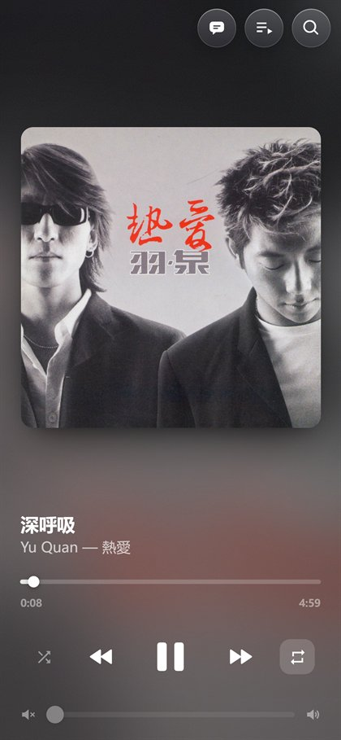
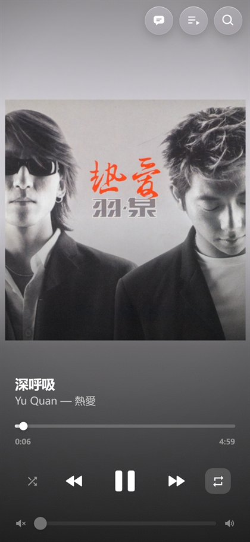
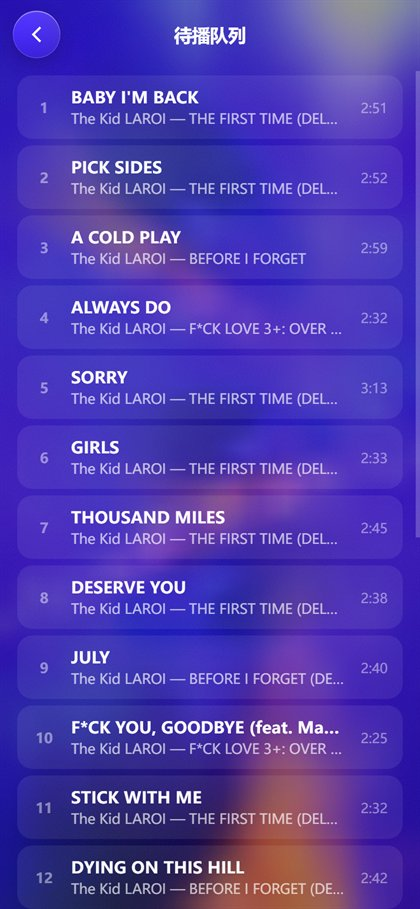
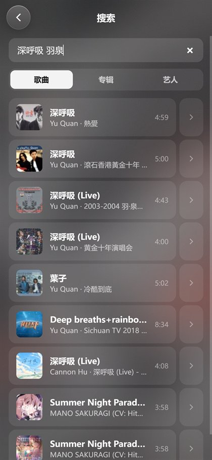
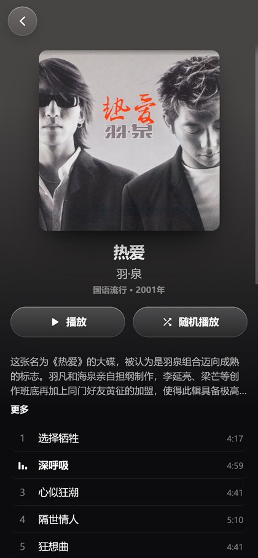

<div align="center">

# 🎵 KX Music Remote

**用手机遥控 Windows 上的 Apple Music**<br>
**A phone remote for Apple Music on Windows**

躺在沙发上就能切歌，再也不用为了一首「下一首」爬起来走到电脑前 🛋️<br>
*Skip songs from the couch. Your legs will thank you.*

<p>
  
  
  
  
  
</p>

**[🥟 中文](#zh)** · **[🍔 English](#en)**

</div>

> 🤖 这个项目主要由 **Claude** 编写，🔧 **GPT** 帮忙修了不少 bug —— 感谢两位 AI 同事！[详情 ↓](#ai)<br>
> 🤖 Mostly written by **Claude**, with 🔧 **GPT** fixing bugs along the way. Thanks, robots! [Details ↓](#ai)

<table>
  <tr>
    <td align="center"><br><sub>🎧 正在播放 · Now playing</sub></td>
    <td align="center"><br><sub>🎞️ 动态封面（截图里不动，实际会动 😉）<br>Motion artwork (it moves, trust me)</sub></td>
    <td align="center"><br><sub>📜 待播队列 · Up Next</sub></td>
  </tr>
  <tr>
    <td align="center"><br><sub>🔍 曲库搜索 · Search</sub></td>
    <td align="center"><br><sub>💿 专辑页 · Album</sub></td>
    <td align="center"><br><sub>🧑‍🎤 艺人页 · Artist</sub></td>
  </tr>
</table>

---

<a id="zh"></a>

## 🥟 中文

### 🤔 这是个啥？

Apple Music 终于有了 Windows 版，可 iPhone 上那个老牌「Remote」遥控 App 连不上它 —— 老 iTunes 用的 DACP 协议，新 App 直接不支持了；Windows 版 Apple Music 也没有任何公开 API。

结果就是：每次想切首歌，都得从沙发上爬起来走到电脑前。忍不了 😤

于是有了 **KX Music Remote**：在 Windows 上跑一个 Python 小服务，家里同一个 Wi-Fi 下的 iPhone、iPad、Mac（或者任何带浏览器的设备），打开网页就能遥控电脑上的 Apple Music。不用装 App，没有 Electron，一个网页搞定 ✌️

### ✨ 能干啥

- 🎧 **正在播放** —— 大封面、歌名歌手，背景是从封面颜色里「流」出来的 WebGL 动态渐变；专辑有动态封面的话直接播动态封面（手机竖屏时铺满全屏）
- ⏯️ **播放控制** —— 播放 / 暂停、上一首 / 下一首、拖动进度条、音量和静音、随机、循环，该有的都有
- 📜 **待播队列** —— 看看接下来放啥，点一下直接跳过去
- 🎤 **滚动歌词** —— QQ 音乐 / 网易云 / 酷狗 / LRCLIB 多源歌词（感谢 [LDDC](https://github.com/chenmozhijin/LDDC)），逐行高亮；手指一划可以自己往回翻，停手 8 秒后自动回到当前这句。歌词快了慢了？全局 ±10 秒微调，所有设备同步
- 🌏 **歌词翻译** —— 繁体自动转简体（OpenCC，本地完成）；外语歌词交给本地 Ollama 里的腾讯混元 **Hy-MT2-7B** 翻成中文，原文在上、译文在下。全程不上云，原歌词骂人译文也照骂 —— 力度对等、不打码、不加戏 🤬
- 🔍 **曲库搜索** —— 搜歌、专辑、歌手，点一下，电脑上的 Apple Music 就开始放
- 💿 **专辑页** & 🧑‍🎤 **艺人页** —— 曲目、简介、热门歌曲、相似艺人，跟在 Apple Music 里逛差不多
- 🫧 **Apple Music 同款手感** —— 歌词波浪式滚动、按钮回弹、封面淡入淡出，还有新版黑白配色和玻璃质感按钮；系统打开「减少动态效果」后全部安静下来
- 🖱️ **一键启动 / 关闭** —— 双击 `一键启动.cmd`：打开 Apple Music、启动 Ollama 并预热翻译模型、打开网页；`一键关闭.cmd` 顺手卸载模型、把显存还给你，Apple Music 照常播放

### 🛠️ 它是怎么做到的？

Windows 版 Apple Music 没有 API，那就借 Windows 自带的系统能力（正经的那种 😇）：

| 功能 | 背后的原理 |
|---|---|
| 歌曲信息、封面、播放 / 暂停 / 切歌 | SMTC 系统媒体传输控制（[`winsdk`](https://github.com/pywinrt/python-winsdk)） |
| 音量、静音 | Windows Core Audio（[`pycaw`](https://github.com/AndreMiras/pycaw)） |
| 进度跳转、随机、循环、待播队列 | UI Automation 无障碍接口（[`uiautomation`](https://github.com/yinkaisheng/Python-UIAutomation-for-Windows)）—— 说白了就是替你去点 Apple Music 的按钮 |
| 曲库搜索、专辑、艺人 | 公开的 iTunes Search API + music.apple.com 页面数据 |
| 在电脑上播放搜索结果 | 先用 `music://` 链接打开专辑，再用 UI Automation 找到那首歌，点「更多 → 播放」（链接只会打开专辑，不会帮你按播放 🙄） |
| 歌词 | [LDDC](https://github.com/chenmozhijin/LDDC) 的多源歌词接口 |
| 翻译 | [OpenCC](https://github.com/BYVoid/OpenCC) + 本地 [Ollama](https://ollama.com)（Hy-MT2-7B） |

整个网页（HTML / CSS / JS）都内嵌在 `apple-music-remote.py` 里，跑起这一个文件就是完整的服务。

### 🚀 快速开始

**准备：**

- Windows 10 / 11 + [Apple Music](https://apps.microsoft.com/detail/9pfhdd62mxs1)（微软商店版）
- Python 3.10+（我用的 3.12）
- Git（歌词库 LDDC 要从 GitHub 安装）
- 跟电脑连同一个 Wi-Fi 的手机
- 可选：[Ollama](https://ollama.com) + Hy-MT2 翻译模型（只有歌词翻译需要它）

**① 安装**

```powershell
git clone https://github.com/LB21321610/kxmusicremote.git
cd kxmusicremote
python -m venv .venv
.\.venv\Scripts\python.exe -m pip install -r requirements.txt
```

**② 放行防火墙**（管理员 PowerShell，只对「专用网络」里的本地网段开放）

```powershell
New-NetFirewallRule -DisplayName "KX Music Remote" -Direction Inbound -Protocol TCP -LocalPort 8765 -Profile Private -RemoteAddress LocalSubnet -Action Allow
```

**③ 启动**

```powershell
.\.venv\Scripts\python.exe apple-music-remote.py
```

终端会打印 `Open on your phone: http://192.168.x.x:8765`，用手机浏览器打开就行 🎉 iPhone 推荐用 Safari →「分享」→「添加到主屏幕」，用起来跟 App 一模一样 📱

> 💡 Apple Music 要先打开，并且至少播放过一首歌，系统里才有它的媒体会话。想换端口：`--port 1234`。

**可选设置**（环境变量，启动前在同一个 PowerShell 里设置；`.env.example` 只是示例，不会自动读取）：

| 变量 | 默认值 | 用途 |
|---|---|---|
| `REMOTE_CATALOG_STOREFRONT` | `us` | 曲库商店地区，改成你 Apple Music 账号所在的地区（比如 `hk`、`tw`、`jp`） |
| `REMOTE_CATALOG_LANGUAGE` | `zh-Hans-CN` | 专辑页、艺人页的文字语言 |
| `HY_MT2_URL` | `http://127.0.0.1:11434` | 本地 Ollama 地址（只接受本机地址） |
| `HY_MT2_MODEL` | `hy-mt2-translate` | 翻译模型名 |

**想要歌词翻译？** 装好 Ollama，准备一个 Hy-MT2 翻译模型并命名为 `hy-mt2-translate`（或者用 `HY_MT2_MODEL` 换成你自己的模型名）。没有模型也不影响：原文歌词和繁简转换照常工作。

**想要双击启动？** `一键启动.cmd` / `一键关闭.cmd` 是我自己每天在用的启动器，安全检查比较严格：

1. 把 `network.example.psd1` 复制一份、改名 `network.local.psd1`，填上你家 Wi-Fi 名称和电脑的局域网 IP（这个文件被 Git 忽略，你的网络信息只留在自己电脑上 🔒）
2. 以管理员身份运行一次 `Configure-Network.ps1`：防火墙只允许你家网段访问 8765 端口，公用网络和域网络一律拦截
3. 以后双击 `一键启动.cmd` 就行。不在家里 Wi-Fi 时它会拒绝启动 —— 这是故意的

### 📁 文件一览

| 文件 | 干嘛的 |
|---|---|
| `apple-music-remote.py` | 服务本体 + 内嵌网页，SMTC / UI Automation 控制都在这 |
| `apple_catalog.py` | 曲库搜索、专辑页、艺人页 |
| `lyrics_multisource.py`、`lddc_worker.py`、`lyrics_matching.py` | 歌词来源和匹配 |
| `lyrics_translation.py` | 繁简转换和本地翻译 |
| `remote_settings.py` | 歌词偏移设置（所有设备共享） |
| `*.cmd`、`*.ps1` | 启动、关闭、防火墙配置 |
| `tests/` | 单元测试、无头浏览器测试、实机验证脚本 |

### 🧪 测试

```powershell
.\.venv\Scripts\python.exe -m unittest discover -s tests -p "test_*.py"
node tests\test_clock.cjs
```

目前 139 项 Python 测试 + 6 项播放时钟测试全部通过 ✅ `tests/` 里还有用无头 Edge / Chrome 跑的界面测试（`verify_*_browser.cjs`，需要 Node），以及会真的操作 Apple Music 的实机脚本（`verify_*_live.py`，会切歌！跑之前先读脚本开头的说明 ⚠️）。

### ⚠️ 已知限制

- 🔓 **没有登录密码**：同一个 Wi-Fi 下谁都能切你的歌。千万别把 8765 端口暴露到公网！
- 🖥️ 点待播队列、从搜索结果播放时，Windows 需要处于解锁状态；Apple Music 窗口可能会跳到前台，鼠标也可能自己动一下 —— 它是真的在替你双击 😅
- 🌐 循环模式的状态只认中文和英文界面
- 🍎 Mac / iPhone 浏览器主要做的是模拟测试，没有逐项真机验证
- 📝 歌词来自第三方，不是 Apple Music 官方歌词；翻译是本地模型机翻，偶尔会翻车
- 🔄 Apple Music 一更新就可能改界面，到时候某些控制可能要修一修

### 🍿 幕后花絮

- **遥控器差点遥控了自己** —— 早期找 Apple Music 窗口是看标题里有没有「Apple Music」，结果找到了浏览器里那个标题叫「Apple Music Remote」的遥控网页本身 🙃 GPT 揪出了这个 bug，现在只认 `AppleMusic.exe` 进程的窗口
- **美区把五月天叫 Mayday** —— 美区商店给很多华语歌用英文名（Mayday、JJ Lin……），歌词一度对不上号。现在会顺手去台湾 / 香港区查一下中文名再匹配
- **队列里的歌手名变成了「豆腐块」** —— Apple Music 在队列行里藏了个私用区图标字符，被当成了歌手名。过滤掉以后，真名回来了

---

<a id="en"></a>

## 🍔 English

### 🤔 What is this?

Apple Music finally made it to Windows, but Apple's old iPhone **Remote** app can't talk to it — the new app dropped DACP, the protocol iTunes used, and there's no public API either.

Which meant getting off the couch every single time I wanted to skip a song. Unacceptable. 😤

So here's **KX Music Remote**: a small Python server on your Windows PC that serves a phone-friendly web remote to every iPhone, iPad and Mac (or anything with a browser) on your home Wi-Fi. No app to install, no Electron — just a web page. ✌️

> 🗣️ Heads-up: the UI is in Chinese (it was built for a Chinese-speaking home), but the icons do most of the talking.

### ✨ Features

- 🎧 **Now playing** — big artwork, title and artist over a WebGL backdrop that flows out of the artwork's colors; albums with motion artwork play it (full screen on phones in portrait)
- ⏯️ **Transport** — play/pause, previous/next, draggable progress bar, volume and mute, shuffle, repeat
- 📜 **Up Next** — see what's coming and tap a song to jump straight to it
- 🎤 **Synced lyrics** — multi-source lyrics from QQ Music, NetEase Cloud Music, Kugou and LRCLIB (thanks to [LDDC](https://github.com/chenmozhijin/LDDC)) with line-by-line highlighting. Scroll back freely; it snaps to the current line 8 seconds after you let go. Lyrics running early or late? A global ±10 s offset, synced across every device
- 🌏 **Translation** — Traditional → Simplified Chinese with OpenCC, plus foreign lyrics translated into Chinese by Tencent's **Hy-MT2-7B** running locally in Ollama. Original on top, translation underneath. Nothing goes to the cloud, and swear words stay swear words — same strength, no asterisks 🤬
- 🔍 **Catalog search** — songs, albums, artists; tap one and it starts playing in Apple Music on the PC
- 💿 **Album** & 🧑‍🎤 **artist pages** — tracks, notes, top songs, similar artists
- 🫧 **That Apple Music feel** — wavy lyric scrolling, springy buttons, cross-fades, the new black-and-white look with glassy buttons; everything calms down when "reduce motion" is on
- 🖱️ **One-click start/stop** — double-click `Start-Remote.cmd` to open Apple Music, start Ollama, warm up the translation model and open the page; `Stop-Remote.cmd` unloads the model to give your VRAM back (the music keeps playing)

### 🛠️ How does it work?

No API, so it leans on things Windows already has (the legit kind 😇):

| What | How |
|---|---|
| Track info, artwork, play/pause/skip | SMTC — System Media Transport Controls ([`winsdk`](https://github.com/pywinrt/python-winsdk)) |
| Volume, mute | Windows Core Audio ([`pycaw`](https://github.com/AndreMiras/pycaw)) |
| Seek, shuffle, repeat, Up Next | UI Automation ([`uiautomation`](https://github.com/yinkaisheng/Python-UIAutomation-for-Windows)) — basically clicking Apple Music's buttons for you |
| Catalog search, albums, artists | The public iTunes Search API + music.apple.com page data |
| Playing a search result on the PC | Open the album with a `music://` link, find the song's row with UI Automation and pick "More → Play" (the link only opens the album — it won't press play for you 🙄) |
| Lyrics | [LDDC](https://github.com/chenmozhijin/LDDC)'s multi-source providers |
| Translation | [OpenCC](https://github.com/BYVoid/OpenCC) + local [Ollama](https://ollama.com) (Hy-MT2-7B) |

The whole web page (HTML/CSS/JS) lives inside `apple-music-remote.py` — run that one file and you've got the full server.

### 🚀 Getting started

**You'll need:**

- Windows 10/11 with [Apple Music](https://apps.microsoft.com/detail/9pfhdd62mxs1) from the Microsoft Store
- Python 3.10+ (I use 3.12)
- Git (the LDDC lyrics library installs straight from GitHub)
- A phone on the same Wi-Fi
- Optional: [Ollama](https://ollama.com) with a Hy-MT2 translation model — only needed for lyric translation

**① Install**

```powershell
git clone https://github.com/LB21321610/kxmusicremote.git
cd kxmusicremote
python -m venv .venv
.\.venv\Scripts\python.exe -m pip install -r requirements.txt
```

**② Open the firewall** (admin PowerShell; private networks and your local subnet only)

```powershell
New-NetFirewallRule -DisplayName "KX Music Remote" -Direction Inbound -Protocol TCP -LocalPort 8765 -Profile Private -RemoteAddress LocalSubnet -Action Allow
```

**③ Run**

```powershell
.\.venv\Scripts\python.exe apple-music-remote.py
```

It prints `Open on your phone: http://192.168.x.x:8765` — open that on your phone and you're done 🎉 On iPhone, use Safari → Share → **Add to Home Screen** and it feels just like an app 📱

> 💡 Apple Music has to be running and must have played at least one song, so Windows knows about its media session. Another port: `--port 1234`.

**Optional settings** (environment variables, set in the same PowerShell before starting; `.env.example` is only an example and isn't loaded automatically):

| Variable | Default | What it does |
|---|---|---|
| `REMOTE_CATALOG_STOREFRONT` | `us` | Catalog store region — use your Apple Music account's region (e.g. `gb`, `jp`, `hk`) |
| `REMOTE_CATALOG_LANGUAGE` | `zh-Hans-CN` | Text language for album and artist pages |
| `HY_MT2_URL` | `http://127.0.0.1:11434` | Local Ollama address (local addresses only) |
| `HY_MT2_MODEL` | `hy-mt2-translate` | Translation model name |

**Want lyric translation?** Install Ollama and set up a Hy-MT2 translation model named `hy-mt2-translate` (or point `HY_MT2_MODEL` at your own model). Without it, original lyrics and Chinese conversion still work fine.

**Want the double-click launcher?** `Start-Remote.cmd` / `Stop-Remote.cmd` (same as `一键启动.cmd` / `一键关闭.cmd`) are the launchers I use every day, and they're strict about security:

1. Copy `network.example.psd1` to `network.local.psd1` and fill in your Wi-Fi name and your PC's LAN IP (Git ignores this file, so your network details stay on your PC 🔒)
2. Run `Configure-Network.ps1` once as administrator: the firewall then only lets your home subnet reach port 8765 and blocks public and domain networks
3. From then on, just double-click `Start-Remote.cmd`. Away from your home Wi-Fi it refuses to start — on purpose

### 📁 What's in here

| File | Job |
|---|---|
| `apple-music-remote.py` | The server plus the embedded web page; SMTC and UI Automation control |
| `apple_catalog.py` | Catalog search, album and artist pages |
| `lyrics_multisource.py`, `lddc_worker.py`, `lyrics_matching.py` | Lyrics sources and matching |
| `lyrics_translation.py` | Chinese conversion and local translation |
| `remote_settings.py` | The lyrics offset shared by all devices |
| `*.cmd`, `*.ps1` | Start, stop and firewall setup |
| `tests/` | Unit tests, headless browser tests, live check scripts |

### 🧪 Tests

```powershell
.\.venv\Scripts\python.exe -m unittest discover -s tests -p "test_*.py"
node tests\test_clock.cjs
```

All 139 Python tests and 6 playback-clock checks pass ✅ `tests/` also has headless Edge/Chrome UI tests (`verify_*_browser.cjs`, needs Node) and live scripts that drive the real Apple Music (`verify_*_live.py` — they change songs! Read the notes at the top of each script first ⚠️).

### ⚠️ Known limitations

- 🔓 **No login.** Anyone on your Wi-Fi can skip your songs. Never expose port 8765 to the internet!
- 🖥️ Tapping an Up Next song or playing a search result needs an unlocked Windows desktop; Apple Music may jump to the front and the mouse may move by itself — it really is double-clicking for you 😅
- 🌐 The repeat state is only recognized in Chinese and English Apple Music
- 🍎 Mac and iPhone browsers were mostly tested in simulation, not item by item on real devices
- 📝 Lyrics are third-party, not Apple Music's official ones; translations come from a local model and sometimes miss
- 🔄 An Apple Music update can change its UI and break some controls until they're fixed

### 🍿 Behind the scenes

- **The remote almost remoted itself** — early on, the app found Apple Music's window by looking for "Apple Music" in the title… and found the browser tab titled "Apple Music Remote" instead 🙃 GPT caught that one; now only windows of the `AppleMusic.exe` process count
- **The US store calls 五月天 "Mayday"** — the US catalog lists many Chinese songs under English names (Mayday, JJ Lin…), so lyrics didn't match. Now it quietly looks up the Chinese names in Apple's Taiwan/Hong Kong catalog too
- **Artist names turned into "tofu" boxes** — Apple Music hides a private-use icon character in queue rows, and it got read as the artist name. Filtered out, real names restored

---

<a id="ai"></a>

## 🤖 鸣谢两位 AI · AI credits

这个项目基本是「人出点子、AI 写代码」做出来的：

- **Claude**（Anthropic）—— 主力 💪 绝大部分功能和代码都出自它手：从界面、动画、歌词和翻译，到曲库搜索、专辑和艺人页，再到测试和文档
- **GPT**（OpenAI，通过 Codex）—— 修代码的好帮手 🔧 做过一轮大检查，修掉了进度条找错窗口、操作失败却显示成功、设置文件并发写入冲突、启动关闭流程等一串 bug

一个负责盖房子，一个负责查漏水。谢谢两位不知疲倦、也不要工资的同事 🙏

This project was built the "human has the ideas, AI writes the code" way:

- **Claude** (Anthropic) — the main developer 💪 Most of the features and code came from it: the UI and animations, lyrics and translation, catalog search, album and artist pages, tests and docs
- **GPT** (OpenAI, via Codex) — the bug fixer 🔧 It ran a full code review and fixed a string of bugs: the progress bar driving the wrong window, failed commands reported as success, clashing writes to the settings file, the start/stop flow

One built the house, the other found the leaks. Thank you both — tireless, and you never once asked for a raise 🙏

## 🙏 也感谢 · Thanks

- [ahmetberber/windows-apple-music-remote](https://github.com/ahmetberber/windows-apple-music-remote) —— 一切的起点，SMTC + UI Automation 的思路和最初的遥控页面都来自这里 · where it all started: the SMTC + UI Automation approach and the first remote page come from here
- [LDDC](https://github.com/chenmozhijin/LDDC)（沉默の金）—— 多源歌词 · multi-source lyrics
- [OpenCC](https://github.com/BYVoid/OpenCC) · [py3langid](https://github.com/adbar/py3langid) · [winsdk](https://github.com/pywinrt/python-winsdk) · [pycaw](https://github.com/AndreMiras/pycaw) · [uiautomation](https://github.com/yinkaisheng/Python-UIAutomation-for-Windows) · [Ollama](https://ollama.com) · 腾讯混元 Tencent Hy-MT2 · [LRCLIB](https://lrclib.net)

## 📄 许可 · License

- 原项目的 MIT 许可保留在 [LICENSE](LICENSE)（版权人 Ahmet Hilmi Berber）· The original project's MIT notice is kept in [LICENSE](LICENSE).
- LDDC 以及 `lddc_worker.py`、`lyrics_matching.py`、`lyrics_multisource.py` 三个歌词适配模块使用 **GPL-3.0-only**，分发包含 LDDC 的整体软件时请遵守 GPL，详见 [THIRD_PARTY.md](THIRD_PARTY.md) 和 [GPL 原文](licenses/LDDC-GPL-3.0.txt) · LDDC and the three lyrics adapter modules are GPL-3.0-only — see [THIRD_PARTY.md](THIRD_PARTY.md).
- 仓库里没有任何歌词数据或模型权重，歌词版权归原作者 · No lyrics or model weights are included; lyrics belong to their rights holders.

<sub>Apple Music 是 Apple Inc. 的商标。这是个人业余项目，与 Apple 没有任何关系。· Apple Music is a trademark of Apple Inc. This is a hobby project, not affiliated with or endorsed by Apple.</sub>
